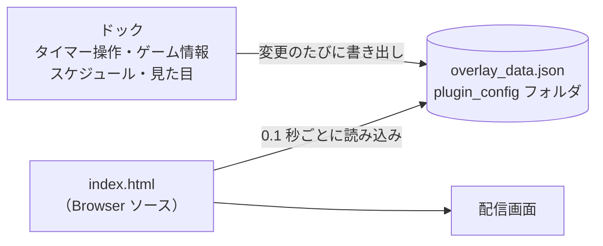
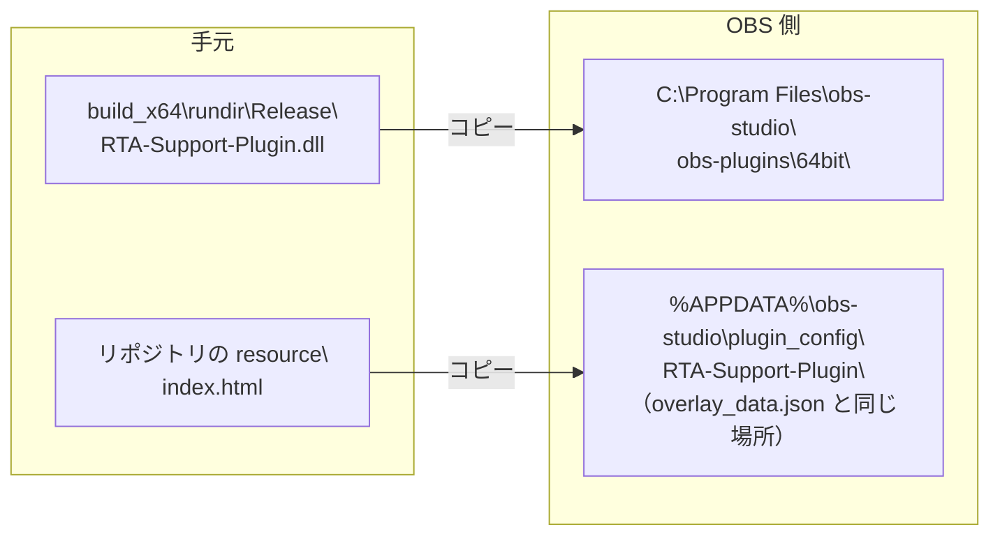
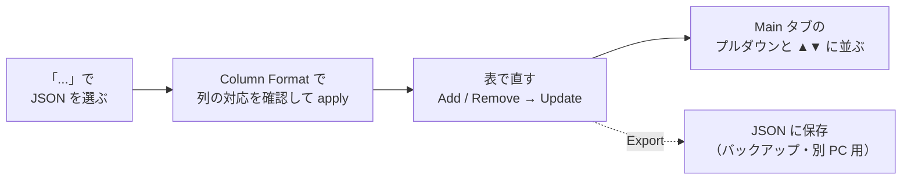
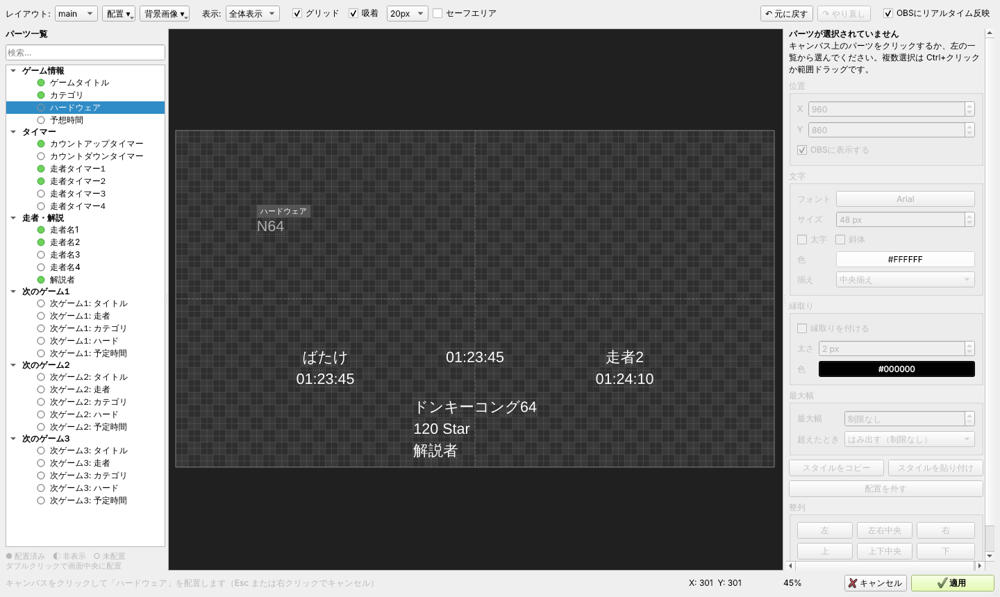
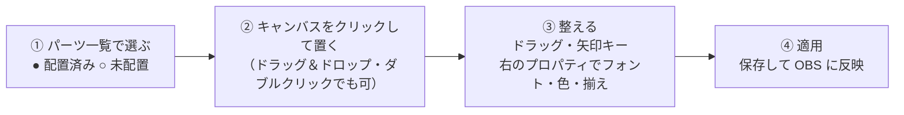
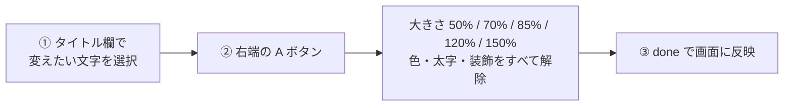
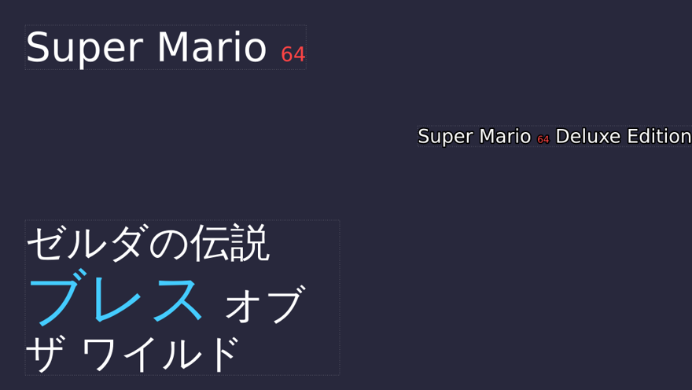
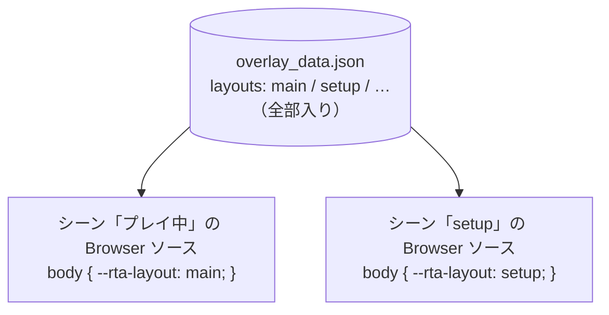

# **RTA Support Plugin**

OBS Studio上でRTAイベント等の進行を支援するためのプラグインです。

「NodeCGでレイアウトとか用意するほどじゃないな…」 とか 「NodeCGとかわかんないけどあんな感じにサクッと情報変更したいな」
みたいな時に使えるようなものを目指して作りました。

タイマー・ゲーム情報・走者名・次のゲームを OBS のドックから操作して、配信画面に表示できます。

> 図をカラーで見たい場合は [docs/usage-guide.html](docs/usage-guide.html) をダウンロードしてブラウザで開いてください（このページと同じ内容です）。

- 対応 OS: Windows（64bit）
- 対応 OBS: 30.1〜32.2（動作確認は 32.1.1）
- 表示: Browser ソース（1920×1080）
- 設定ファイル: UTF-8 の JSON

## 目次

1. [しくみ](#しくみ)
2. [インストール](#インストール)
3. [OBS に表示する](#obs-に表示する)
4. [Main タブ（本番中に触る画面）](#main-タブ本番中に触る画面)
5. [Schedule タブ（スケジュールの取り込み）](#schedule-タブスケジュールの取り込み)
6. [Design タブ（見た目と配置）](#design-タブ見た目と配置)
7. [ビジュアルエディタ（画面を見ながら配置）](#ビジュアルエディタ画面を見ながら配置)
8. [タイトルの一部だけ大きさや色を変える](#タイトルの一部だけ大きさや色を変える)
9. [レイアウトの使い分け](#レイアウトの使い分け)
10. [Global タブ（全体の設定）](#global-タブ全体の設定)
11. [本番当日の流れ](#本番当日の流れ)
12. [困ったとき](#困ったとき)

---

## しくみ

操作はすべて OBS の中のドック「RTA Support Plugin」で行います。ドックで何かを変えるたびに、プラグインは `overlay_data.json` に最新の内容を書き出します。配信画面に表示しているのは Browser ソースで読み込んだ `index.html` で、このページが 0.1 秒ごとに JSON を読み直して文字を描き直します。



このため、**`index.html` と `overlay_data.json` は同じフォルダに置く**必要があります。プラグインが JSON を書き出す場所は決まっているので、`index.html` をそこへコピーするのがいちばん簡単です。

---

## インストール

置くファイルは 2 つです。プラグイン本体の DLL と、表示用の `index.html` です。



1. **OBS を終了します。** 起動中は DLL を差し替えられません。タスクトレイに残っていないかも確認してください。
2. **DLL をプラグインフォルダにコピーします。** `build_x64\rundir\Release\RTA-Support-Plugin.dll` を `C:\Program Files\obs-studio\obs-plugins\64bit\` に置きます。OBS を別の場所にインストールしている場合は、その中の `obs-plugins\64bit` です。
3. **OBS を起動してドックを表示します。** メニューの「ドック」に **RTA Support Plugin** が増えているので、チェックを入れて表示します。
4. **一度だけ保存操作をします。** Main タブで何か入力して `done` を押すと、設定フォルダに `overlay_data.json` が作られます。
5. **`index.html` を設定フォルダにコピーします。** リポジトリの `resource\index.html` を `%APPDATA%\obs-studio\plugin_config\RTA-Support-Plugin\`（いま作られた `overlay_data.json` と同じ場所）に置きます。`%APPDATA%` はエクスプローラーのアドレス欄にそのまま入力すると開けます。

> [!TIP]
> 普段の配信用とは別に、イベント専用の**シーンコレクション**を作ってその中で使うのがおすすめです。普段のシーンを崩さずに済みます。

---

## OBS に表示する

1. シーンに「ブラウザ」ソースを追加します。
2. 「ローカルファイル」にチェックを入れ、設定フォルダに置いた `index.html` を選びます。
3. 幅 **1920**・高さ **1080** にします。配置の座標はすべて 1920×1080 の画面を基準にしています。ソースは画面全体に重ねてください。
4. （必要なら）カスタム CSS でレイアウトを指定します。何も書かなければ `main` レイアウトで表示されます。詳しくは[レイアウトの使い分け](#レイアウトの使い分け)を見てください。

---

## Main タブ（本番中に触る画面）

タイマーと、いま走っているゲームの情報を操作します。本番中はほぼこのタブだけで完結します。

```
 main | schedule | design | global
 ─────────────────────────────────────
 ① Timer 01:23:45   CountDownTimer 00:15:00
 ② [Start] [Stop] [Reset]
 ③ (•)TimerOnly ( )CountDownOnly ( )Both ( )None
 ④ [Super Mario 64 ▾] [▲] [▼]
 ⑤ GameTitle [Super Mario 64  A]
    Category [120 Star]   Platform [N64]   EST [01:45:00]
 ⑥ Runner1 [ばたけ] [Stop]
    Runner2 [走者2] [Stop]   （Runner3・4 も同様）
    Commentator [解説者]
 ⑦ [done]
```

1. **タイマー表示**　左がカウントアップ、右がカウントダウンです（どちらも `時:分:秒`）。カウントダウンの初期値は右の欄に入力して `done` を押すと記録され、`Reset` でその値に戻ります。
2. **`Start` / `Stop` / `Reset`**　計測開始・停止・リセットです。リセットするとカウントアップは 0、カウントダウンは初期値に戻ります。計測中は `done` と ▲▼ が押せなくなり、誤操作で表示が切り替わるのを防ぎます。
3. **表示モード**　カウントアップのみ／カウントダウンのみ／両方／非表示 から選びます。
4. **ゲーム選択**　プルダウンで選ぶと、そのゲームの情報が下の入力欄に読み込まれます。**▲▼ を押すと前後のゲームに切り替わり、そのまま画面にも反映されます。** プルダウンで選んだときは、確認してから `done` を押します。
5. **ゲーム情報**　タイトル・カテゴリ・機種・予定時間を手で直せます。タイトル欄の右端の **A** ボタンは、文字の一部だけ大きさや色を変える機能です（[後述](#タイトルの一部だけ大きさや色を変える)）。
6. **走者と個人タイム**　並走では各走者の `Stop` を押すと、その瞬間のカウントアップの値が「走者タイマー」として記録されます。カウントアップが表示されているモード（TimerOnly か Both）で使ってください。記録は `Reset` で消えます。
7. **`done`**　入力欄の内容を確定し、画面に反映します。

> [!NOTE]
> 停止中のタイマーの文字色は Global タブの「TimerStopColor」で決まります。計測中は Design タブで設定した色で表示されます。

---

## Schedule タブ（スケジュールの取り込み）

イベントの走順を JSON で読み込んでおくと、本番中は ▲▼ を押すだけで次のゲームに切り替えられます。



### 読み込める JSON の形

列名の一覧 `columns` と、各ゲームの行 `items` を持つ形式です。`length_t` は予定時間（秒）です。

```json
{
  "schedule": {
    "columns": ["Game", "Category", "Platform", "Runner", "Commentary"],
    "items": [
      { "data": ["Super Mario 64", "120 Star", "N64", "ばたけ", "解説者A"], "length_t": 6300 },
      { "data": ["ドンキーコング64", "Any%", "N64", "走者1, 走者2", ""], "length_t": 5400 }
    ]
  }
}
```

- 読み込むと、列名のキーワードから「どの列がタイトルか」などが自動で推測されます。**Column Format** の 5 つのプルダウン（GameTitle / Category / Platform / RunnerName / Commentator）で正しいか確認し、違っていれば選び直してから `apply` を押します。
- 並走など走者が複数いるときは、走者の欄に**カンマ区切り**で書きます。左から順に Runner1〜4 に入ります。
- スケジュールは保存され、OBS を再起動しても残ります。
- ファイルは必ず **UTF-8** で保存してください。

> [!TIP]
> 配信画面の「次のゲーム1〜3」には、いま選んでいるゲームの次から 3 件が自動で入ります。待機画面で次の予定を見せたいときに使えます。

---

## Design タブ（見た目と配置）

画面に出す文字（パーツ）ごとに、位置・フォント・色などを決めます。設定は「レイアウト」単位でまとめて保存されます。パーツは全部で 30 個あります。

| 分類 | パーツ |
|---|---|
| ゲーム情報 | ゲームタイトル、カテゴリ、ハードウェア、予想時間 |
| タイマー | カウントアップ、カウントダウン、走者タイマー1〜4 |
| 走者・解説 | 走者名1〜4、解説者 |
| 次のゲーム1〜3 | それぞれ タイトル・走者・カテゴリ・ハード・予定時間 |

### 細かい数値で調整する

「TextName」で編集するパーツを選び、次の項目を設定します。ふだんの配置は[ビジュアルエディタ](#ビジュアルエディタ画面を見ながら配置)の方が速いので、こちらは数値をきっちり合わせたいときに使います。

| 項目 | 内容 |
|---|---|
| TextFont / TextColor | フォント（種類・大きさ・太字・斜体）と文字色 |
| TextPosition | X / Y 座標（1920×1080 基準）。ここで座標を入れたパーツは「配置済み」になります |
| 揃え | 左・中央・右。中央揃えなら X は文字の中心、右揃えなら右端の位置になります |
| outline | 縁取りの有無・太さ・色。背景が明るい場所で読みやすくなります |
| TextMaxWidth / WrapMode | 最大幅（0 は制限なし）と、はみ出したときの扱い（制限なし／自動縮小／自動改行）。長いタイトル対策に便利です |

### レイアウトの管理

- `Add`：いまのレイアウトを元に新しいレイアウトを作ります。新しいレイアウトは全パーツ「未配置」から始まります。
- `Delete`：選択中のレイアウトを削除します（確認あり）。
- `SaveLayout` / `LoadLayout`：レイアウトを JSON ファイルに書き出し／読み込みします。バックアップや別 PC への移行に使います。
- **SyncSceneChange**：チェックを入れると、レイアウトを切り替えたときに同じ名前の OBS シーンにも切り替わります。

---

## ビジュアルエディタ（画面を見ながら配置）

Design タブの「ビジュアルエディタ」ボタンで開きます。配信画面と同じ 1920×1080 のキャンバスに、パーツを置いていく方式です。





「OBSにリアルタイム反映」がオンなら、③ の途中から OBS の画面も一緒に動きます。「キャンセル」を押すと開いた時点の状態に戻ります。

### 覚えておきたいこと

- **未配置のパーツは OBS に表示されません。** 使わないパーツは置かなければ出ません。置いたものを消したいときは `Delete` キーか右クリック「配置を外す」で一覧に戻します。
- 一時的に隠したいだけなら、プロパティの「OBSに表示する」のチェックを外します（配置は残ります）。
- キャンバスには実際の文字が、設定中のフォント・色・縁取りで表示されます。空のパーツは「Super Mario 64」のような仮の文字で表示されます。
- 複数選択（`Ctrl`+クリック、または範囲ドラッグ）すると、まとめて移動・スタイル変更・整列ができます。
- 「背景画像」でフレーム画像などを敷いて、それに合わせて配置できます。背景はエディタ内だけの表示で、OBS には出ません。

### 「配置」メニュー

| メニュー | 内容 |
|---|---|
| 1人走（右側に情報欄） | 右側にタイトル・カテゴリ・機種・予定時間・走者・タイマー・解説を縦に並べます |
| 2人並走 | 左右に走者名と走者タイマー、中央にタイマー、下にタイトル・カテゴリ・解説を置きます |
| 4人並走（4分割） | 4 分割の各画面の下に走者名と走者タイマー、中央にタイマーを置きます |
| 待機画面（次のゲーム3件） | 上に現在のタイトル・カテゴリ、その下に次のゲーム 1〜3 のタイトル・カテゴリ・走者・予定時間を並べます |
| 別レイアウトから複製 | 他のレイアウトの配置をそのまま取り込みます |
| すべて未配置に戻す | やり直したいときに使います |

プリセットで大まかに並べてから、ドラッグで微調整するのが早いです。

### ショートカット

| キー | 動作 |
|---|---|
| 矢印キー | 選択中のパーツを 1px 移動 |
| `Shift` + 矢印キー | 10px 移動 |
| `Alt`（ドラッグ中） | 一時的に吸着を無効にする |
| `Delete` | 配置を外して一覧に戻す |
| `Ctrl` + `C` / `V` | スタイル（フォント・色など）をコピー／貼り付け。走者名1 の見た目を 2〜4 にそろえるときに便利 |
| `Ctrl` + `Z` / `Y` | 元に戻す／やり直し |
| `Esc` / 右クリック | 配置待ちの状態を取り消す |

---

## タイトルの一部だけ大きさや色を変える

「Super Mario <sub>64</sub>」のように、ゲームタイトルの一部だけ小さくしたり色を変えたりできます。





- 使えるのは**大きさ（% 指定）・色・太字**です。大きさは要素のフォントサイズに対する割合なので、Design タブで基本の大きさを変えても比率は保たれます。
- 入力欄には `<span style="font-size:50%">64</span>` のようなタグが入ります。タグを手で書いても同じ結果になります。
- 装飾をやめたいときは、文字を選んで「装飾をすべて解除」を選びます。
- ゲーム選択のプルダウンには、タグを除いた文字が表示されます。
- スケジュール JSON のタイトルに同じタグを書いておけば、読み込んだ時点から装飾付きで表示されます。

---

## レイアウトの使い分け

「プレイ中」と「待機画面」のように、シーンごとに配置を変えたいときの設定です。

どのレイアウトで表示するかは、**Browser ソースごと**にカスタム CSS で決めます。シーンごとに Browser ソースを置き、それぞれに使いたいレイアウト名を書いておけば、シーンを切り替えるだけで配置も切り替わります。



1. **Design タブでレイアウトを作ります。** `Add` で例えば `setup` を作り、ビジュアルエディタで「待機画面（次のゲーム3件）」プリセットを当てます。
2. **待機画面のシーンに Browser ソースを追加します。** 設定は [OBS に表示する](#obs-に表示する) と同じです。
3. **カスタム CSS にレイアウト名を書きます。** Browser ソースのプロパティの「カスタム CSS」に次の 1 行を追記します。何も書かないソースは `main` で表示されます。

   ```css
   body { --rta-layout: setup; }
   ```

> [!TIP]
> レイアウト名と OBS のシーン名を同じにしておき、Design タブの **SyncSceneChange** をオンにすると、ドックでレイアウトを切り替えたときに OBS のシーンも同じ名前のものに切り替わります。

---

## Global タブ（全体の設定）

| 項目 | 内容 |
|---|---|
| Runner1〜4_Icon / Commentary_Icon | 走者名・解説者名の前にアイコンを付けます。名前が空のときは表示されません |
| AutoScreenShotFlag | TimerStart / TimerStop にチェックすると、タイマー開始時・停止時に OBS のスクリーンショットを自動で撮ります。記録の証拠用に便利です |
| TimerStopColor | タイマー停止中の文字色 |
| ScreenShot | 押した瞬間にスクリーンショットを撮ります |

スクリーンショットは OBS の録画と同じ保存先に作られます。事前に保存先と空き容量を確認しておいてください。ここでの設定は保存され、再起動後も残ります。

---

## 本番当日の流れ

| いつ | やること |
|---|---|
| 前日まで | スケジュール JSON を読み込み、レイアウトを作って配置を決めます。Browser ソースで表示を確認し、`Export` と `SaveLayout` でバックアップを取っておきます |
| 開始前 | 最初のゲームをプルダウンで選んで `done`。表示モードとカウントダウンの初期値を確認し、`Reset` でタイマーを 0 にします |
| 走行開始 | `Start`。自動スクリーンショットがオンなら、この時点で 1 枚撮られます |
| 走行中 | 並走なら、走者がゴールした順に各走者の `Stop` を押して個人タイムを記録します |
| 完走 | 全体の `Stop`。停止色に変わったタイムがそのまま画面に残ります |
| 次のゲーム | `Reset` してから **▼**。次のゲームの情報が読み込まれ、画面にもすぐ反映されます。必要ならシーンを待機画面に切り替えます |

> [!IMPORTANT]
> 計測中は ▲▼ と `done` が押せません。次のゲームへ進む前に、必ず Stop → Reset の順で止めてください。

---

## 困ったとき

<details>
<summary>ドックのメニューに RTA Support Plugin が出てこない</summary>

DLL の置き場所を確認してください。`obs-plugins\64bit` の中に `RTA-Support-Plugin.dll` があるか、OBS を完全に終了してから置いたかを見直します。このプラグインは OBS 30.1〜32.2 向けです。30.0 以前の OBS では読み込まれません。
</details>

<details>
<summary>Browser ソースに何も表示されない</summary>

`index.html` と `overlay_data.json` が同じフォルダにあるか確認してください。`overlay_data.json` がまだ無い場合は、ドックで一度 `done` を押すと作られます。パーツがビジュアルエディタで「未配置」のままだと表示されないので、配置済み（緑の丸）になっているかも確認します。
</details>

<details>
<summary>待機画面用のソースが main の配置で出てしまう</summary>

カスタム CSS の書き方を確認してください。`body { --rta-layout: setup; }` のように `body` に対して書き、レイアウト名はドックの表示と大文字・小文字まで一致させます。
</details>

<details>
<summary>スケジュールを読み込んだら文字化けした</summary>

JSON を UTF-8 で保存し直して、もう一度読み込んでください。
</details>

<details>
<summary>走者タイマーが空欄のまま</summary>

表示モードが CountDownOnly か None になっていると、走者の `Stop` を押しても記録されません。TimerOnly か Both にしてください。
</details>

<details>
<summary>長いタイトルが画面からはみ出す</summary>

Design タブかビジュアルエディタのプロパティで最大幅を設定し、はみ出したときの扱いを「自動縮小」か「自動改行」にします。
</details>

<details>
<summary>設定をバックアップ・別の PC に移したい</summary>

レイアウトは `SaveLayout`、スケジュールは `Export` で書き出せます。すべてまとめて移すなら、設定フォルダの `overlay_data.json` をコピーします。
</details>

---

## ⚠️ 注意事項・仕様

* **対応OBS**: 30.1〜32.2（OBS 30.1.2 と同梱の Qt 6.6 に合わせてビルドしているため、それより新しい OBS でも読み込めます。30.0 以前では表示されません）
* **動作確認**: OBS 32.1.1
* **対応OS**: Windows (64bit)
* **文字コード**: JSONファイルは必ず **UTF-8** で保存してください。
* **ライセンス**: 本プラグインは Qt 6 (LGPLv3) を使用しています。プラグイン自体は GPLv2 に準拠します。
* **ご利用に関しては自己責任でお願いします**

## 作者

oimobatake
